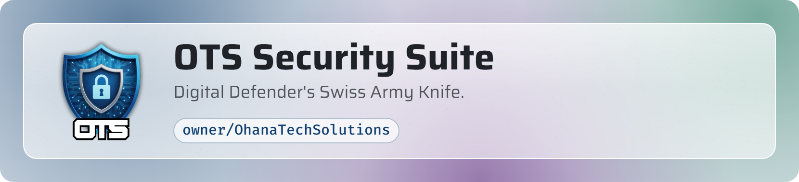

<p align="center">
  <picture>
    <source media="(prefers-color-scheme: dark)" srcset="art/SecuritySuite-header-dark.png" />
    <source media="(prefers-color-scheme: light)" srcset="art/SecuritySuite-header-light.png" />
    
  </picture>
</p>

# OTS Security Suite

<p align="center"><strong>Your Cybersecurity Swiss Army Knife. One Suite. Every Tool. Every Defense.</strong></p>

<p align="center">A Windows launch hub for independently installed third-party security programs. Not another proprietary malware scanner.</p>

<p align="center">  </p>

> **Corrected scope, November 18, 2026:** Older **v0.9.0-test.5** and earlier installers ship our retired RepoScan-centered interface. **Do not use those installers to judge the new product.** This new hub is being built on [the upstream-hub feature branch](https://github.com/ohanatechsolutions/OTS-Security-Suite/tree/feature/upstream-security-tool-hub-20261118). The hub is **not production-approved**; a new downloadable installer is valid only if its own Windows CI and package inspection pass.

## Why This Exists · Problem, Purpose, Solution

Security practitioners already use reliable open-source cybersecurity tools. The problem is jumping between disparate native programs, documentation and command-line workflows. This project **does not recreate or replace those engines**. It provides a single index for the selected original tools, preserves their real native experiences when available, and visibly distinguishes installed, unconnected and manual-only modules.

| The problem | The purpose | The solution |
|---|---|---|
| Scattered third-party security applications and inconsistent launch paths | Keep an organized, free, local hub without claiming to reinvent security products | Per-tool Windows pages with official upstream links, explicit executable connections, and safe launch or CLI-help options |

## Selected Upstream Tool Catalog

| Category | Program | Integration in the hub |
|---|---|---|
| Endpoint Protection | **Microsoft Defender / Windows Security** | Opens Windows' actual Security interface. Never installs or disables AV |
| Endpoint Protection | **ClamAV** | Connects to installed `clamscan.exe`, displays official CLI help |
| Endpoint Protection | **YARA-X** | Connects to installed `yr.exe`, displays official CLI help |
| Endpoint Visibility | **osquery** | Connects to installed `osqueryi.exe`, displays official CLI help |
| Backup & Recovery | **KopiaUI** | Launches the original installed Kopia graphical application |
| Incident Investigation | **Hayabusa** | Connects to installed `hayabusa.exe`, displays official CLI help |
| Hardening & Telemetry | **HardeningKitty** | Official upstream docs; no elevated scripts executed |
| Hardening & Telemetry | **Microsoft Sysmon** | Official upstream docs; no service/driver installation |
| Incident Investigation | **PE-sieve** | Connects to installed `pe-sieve.exe`, displays official CLI help |
| Code & Supply Chain | **TruffleHog** | Connects to installed `trufflehog.exe`, displays official CLI help |
| Code & Supply Chain | **OSV-Scanner** | Connects to installed `osv-scanner.exe`, displays official CLI help |
| Code & Supply Chain | **Semgrep Community Edition** | Connects to installed `semgrep.exe`, displays official CLI help |
| AI & Agent Security | **NVIDIA SkillSpector** | Official upstream docs; runtime/platform checks still required |
| Authorized Penetration Testing | **Strix** | Official upstream docs; no automatic autonomous execution |

Each tool has an independent project link in the actual interface; source references and licensing/feasibility caveats are documented in [the hub decision log](docs/THIRD_PARTY_HUB_DECISION.md).

**Product behavior:** No vendor executables, models, Docker images, signatures, external API keys or paid cloud services are bundled or automatically installed. A genuine GUI such as KopiaUI opens as its own program with its original windows and executable icon. A command-line tool has **no original GUI to embed**; the hub can connect to that tool's executable and show its real `--help` output, without running scans. Installed vendor icons are read from the selected binary; uninstalled tools show a neutral generic symbol, never a fabricated logo.

## Explicitly Removed from the Shipped Product

- **RepoScan / OTSScannerEngine:** not built or installed; no localhost web scanner or WebView2 scanner UI.
- **OTS W.H.I.T.E.:** no standalone tab, scanning controls or Python executable.
- **OTS System Sanitizer:** no cleanup, quarantining or old sanitizer executable.
- **OTS Firewall79X / bespoke Network Defense:** no in-house firewall or system-modification engine.
- **Legacy Chrome RepoScan extension and `ots-security://` protocol:** not shipped/registered by the hub.

The historical code remains in Git for preservation and comparison, **not** in the application build. The upgrade installer explicitly removes known obsolete *application-installation* folders (`engines`, `extension`), but does not delete original source repositories, user profiles, reports or quarantined data.

## Local Build / QA

Windows 10/11 x64, .NET 10 SDK and Inno Setup 6 are needed to reproduce the packaging build. The hub itself does not require Go, Python runtime, RepoScan, Docker or a paid API.

```powershell
python -m unittest discover -s tools -p test_hub.py -v
dotnet publish src/OTSSecuritySuite.Hub/OTSSecuritySuite.Hub.csproj -c Release -r win-x64 --self-contained true -o bundle
& "${env:ProgramFiles(x86)}\Inno Setup 6\ISCC.exe" installer/OTS-Security-Suite.iss
Get-FileHash artifacts/OTS-Security-Suite-Setup-x64.exe -Algorithm SHA256
```

A GitHub Windows workflow runs these checks plus installer/launch/uninstall smoke testing. A **7-day owner-test artifact** may be retained for the authorized PR after the entire job passes; a CI success does not equal independent end-user acceptance or a signed production release.

## Safety and Release Gates

No original upstream license is inferred to grant rights to rebundle or rebrand its executable. All upstream programs remain vendor-owned and user-managed. Do not run privileged hardening, network testing or incident-response scans automatically.

The hub is an *organizer*, not a protection product. Defender and other installed antivirus products retain control of real-time protection. Manual Windows 10/11 verification, accessibility/DPI checks, actual vendor installations, publisher signing, and third-party license review remain release gates.

See [hub migration](docs/THIRD_PARTY_HUB_DECISION.md), [project status](docs/PROJECT_STATUS.md), [release gates](docs/RELEASE-GATES.md) and [CI evidence](docs/TEST_EVIDENCE.md).

---

<p align="center">© Ohana Tech Solutions · All third-party names, icons and software belong to their respective owners.</p>
